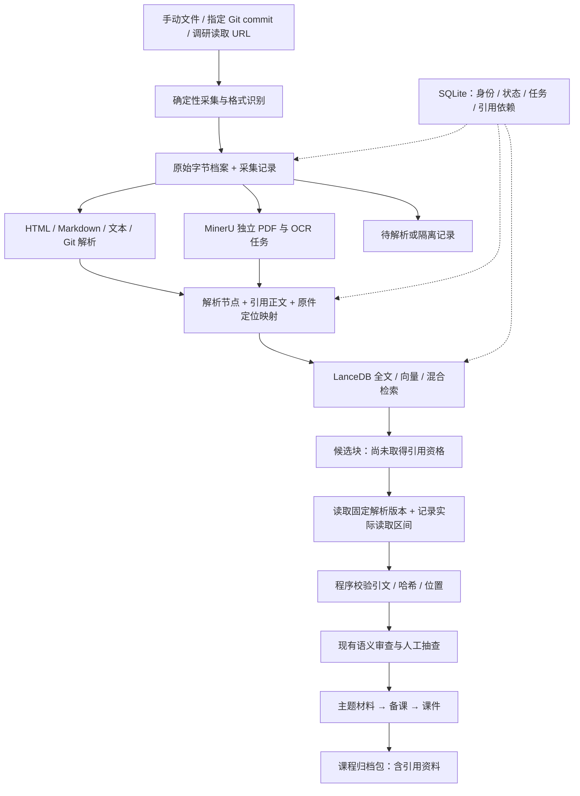

# 原材料库架构与实施方案

> 方案版本：1.0 · 日期：2026-11-25 · 状态：方案稿，尚未进入编码。
> 本轮任务编号：SC-PLAN；后续实施编号：SC0～SC8。
> 文中的目录、数据结构、工具和 CLI 均为拟议契约，不表示当前已经实现。新增依赖及 Agent 循环改动仍遵守仓库对齐要求。

## 01 · 目标与推荐决策

建立一个服务现有课堂调研流程的本地原材料库：资料能够长期保存、跨任务复用、按版本回读，引用能够回到当时实际使用的正文和原始位置。

推荐架构：**按需多源采集 → 不可变资料档案 → 按格式解析 → 全文与向量混合检索 → 实际读取登记 → 现有证据核验 → 主题材料 → 课件。**

首版采用以下决策：

| 决策 | 推荐方案 | 原因 |
| --- | --- | --- |
| 资料如何增长 | 少量手动种子资料＋调研时自动归档 | 围绕真实问题积累，避免先建设通用爬虫 |
| 原始资料保存 | 本地文件系统、按 SHA-256 内容寻址、禁止覆盖 | 去重、恢复和独立校验 |
| 元数据 | 独立 SQLite catalog | 与学习状态分离，支持状态、任务和引用依赖 |
| 检索 | LanceDB Embedded，先建立全文基线，再验证混合检索 | 不增加数据库服务；能够在同一语料上比较方法 |
| PDF 与 OCR | MinerU 独立环境、独立任务；适用范围以锁定版本样本为准 | API 启动与模型下载、复杂解析解耦 |
| embedding | 独立版本配置；优先试验多语 HTTP embedding 服务，本地模型作为候选 | 复用现有 HTTP 能力，先验证中文问题检索英文资料的效果 |
| Agent | 保留独立 research 循环，只增加精选的搜索与读取动作 | 不引入调度所有 Agent 的新循环 |
| 旧材料 | 双读兼容，按需导入，不全量改写 | 不破坏已发布课程、恢复绑定和人工标签 |
| 默认检索策略 | 全文可独立运行；混合检索通过评测后再设为默认 | embedding 故障不应导致已保存资料不可读 |

完成后能够回答三个具体问题：这段话来自哪个文件版本；程序核验的是哪一份解析文本；人能否打开当时的原件位置。

## 02 · 已核实的项目现状

2026-11-25 对 `apps/api/data/research/` 顶层 `*.material.json` 的只读盘点结果：

| 项目 | 结果 | 解释边界 |
| --- | --- | --- |
| 材料文件 | 12 份 | 不包括归档目录、draft 和检查点文件 |
| 带正文快照的材料 | 2 份 | 另外 10 份为旧格式材料 |
| 已保存正文快照 | 23 份，内容哈希均不同 | 本次未发现重复快照，不据此承诺显著节省存储 |
| 快照哈希校验 | 23/23 一致 | 证明保存内容未变化，不证明来源正确或全文完整 |
| 快照 UTF-8 总大小 | 175,776 字节 | 当前规模尚未体现容量压力 |
| 来源条目 | 132 条，其中 16 条为 GitHub URL | URL 分类不能代替格式识别；GitHub 链接不等于 commit 快照 |
| 正文长度 | 最小 3,278、中位数 7,912、最大 7,978 字符 | 现有抓取工具有 8,000 字符截断上限 |

关键代码关系：

- `app/agent/tools.py`：`fetch_page` 优先第三方正文提取，回落 HTML 下载与剥标签；返回正文有截断上限。已有原料调研专用 `read_snapshot`，从当前任务检查点回读。
- `app/agent/research.py`：来源资格依赖实际成功抓取；大纲和原料均有来源校验；原料已有检查点、状态与恢复相关代码。
- `app/services/evidence.py`：`locate_material` 构造快照和引文位置；`material_evidence` 重验已保存正文及哈希。
- `app/schemas/csl.py`：`EvidenceItem.source_id` 为材料内部整数编号；引文位置基于归一化正文字符偏移。
- `app/services/publication.py`：使用材料和实际课件正文生成发布检查；`human_evidence_review.py` 将人工标签绑定到内容与证据哈希。

现有资料最先需要补齐的是原件保存和版本身份。历史正文可迁入来源库，但应标记为“历史提取快照、原始文件未保存、完整性未知”；不得标成完整原件。

## 03 · 范围与交付边界

首版完整交付包含以下三段，可以逐段验收：

1. **档案闭环**：手动导入、原件保存、版本管理、解析、定位、旧材料兼容、导出恢复。
2. **检索闭环**：全文检索、embedding、混合排序、固定问题集对比、降级与重建。
3. **课堂闭环**：调研优先复用资料、缺失时联网、自动归档、实际读取登记、材料和课件证据链贯通。

格式范围：

| 输入 | 首版处理 | 保留的定位 |
| --- | --- | --- |
| HTML | 保存响应主体，再抽取正文、标题、段落、代码和表格 | 请求 URL、最终 URL、标题路径、正文位置；DOM 锚点可用时保留 |
| Markdown、纯文本 | 保存原始字节，确定性解析 | 文件或 URL、标题路径、原文件行号 |
| Git 文档与文本代码 | 固定 commit，按允许路径读取文件；不执行仓库代码 | 仓库、commit、路径、行号和 blob OID |
| 原生 PDF、扫描 PDF | MinerU 独立任务，分别用样本验收 | PDF 页序、可用的印刷页码、块及坐标 |
| PNG、JPEG 文档图片 | 仅启用经样本验证的 OCR 路径 | 原图、图片序号、可用坐标、机器识别标记 |
| JSON、XML、CSV | 首版可靠归档；结构解析作为 SC3 的后续小批次，未接入前标待解析 | 启用解析时保留字段路径或行列，不把展平文本冒充原结构 |
| DOCX、PPTX、音视频、动态页面 | 保存可取得的原件，明确待解析或不支持原因 | 不生成伪正文、不进入可引用检索集 |

首版不包含来源管理 Web 页面、全站爬取、登录态采集、浏览器自动化、全文翻译、生成资料后自动改写历史课程、自动删除原件、分布式写入及数据库服务迁移。

学习知识库继续只读。`research/*.material.json` 继续表达一次调研对主题的整理，不被来源库取代。

## 04 · 架构与职责



四类数据职责：

- **文件系统**保存不可变原件、解析节点、引用正文、定位映射和失败诊断。
- **SQLite**保存来源身份、版本关系、任务状态、选用版本及引用依赖，是状态事实源。
- **LanceDB**保存可重建的检索副本，不作为唯一原文存储。
- **主题材料与课件**保存主题结论、必要摘录、上下文和固定快照引用，不携带完整资料。

采集和入库由确定性代码负责。Agent 只获得必要搜索、读取与现有联网动作，不获得任意 SQL、索引写入、删除、解析器安装或 shell 工具。

## 05 · 目录与保留规则

```text
apps/api/data/source-corpus/
  raw/sha256/ab/<raw_sha256>           原始字节，跨来源按内容去重
  parsed/<parse_id>/
    manifest.json                     输入、解析器、配置、输出哈希
    document.json                     标准节点和原件定位
    citation.txt                      固定版本的可引用正文
    citation-map.json                 引用正文到节点与原件位置的映射
    assets/                           解析产生的图片等必要附件
  catalog.sqlite                      元数据、任务、引用依赖
  lancedb/                            派生检索数据
  quarantine/<attempt_id>.json         原件引用、原因、阶段和重试信息
  staging/<job_id>/                    下载、解析、建索引的临时现场
  exports/                            显式导出的资料包
```

`quarantine` 保存诊断和原件引用，避免再复制大文件。未支持的格式使用 `pending_parser`，解析异常使用 `failed`，不把正常等待适配器与文件损坏混为同一状态。

已有 hash 路径写入时重验内容；同 hash 不覆盖、不同内容不复用同一路径。解析结果先落临时目录，通过输出校验后发布为不可变目录。

首版不实现自动清理。已被材料、课程或恢复绑定引用的原件与解析版本必须保留；LanceDB 可重建。未来清理先计算依赖、只预览候选，并另行取得删除授权。

## 06 · 身份与版本契约

| 身份 | 含义 | 是否随处理变化 |
| --- | --- | --- |
| `corpus_source_id` | 一个逻辑文档的全局身份 | URL 别名变化可保留身份；不可盲目合并 |
| `revision_id` | 来源的一份固定采集内容或 Git 文件版本 | 内容或 commit 变化时新增 |
| `raw_sha256` | 保存字节的 SHA-256 | 相同字节可跨来源共享 |
| `parse_id` | 固定 revision＋解析器/模型版本＋配置＋归一化版本 | 任一相关输入变化时新增 |
| `chunk_set_id` | 固定 parse＋切块算法与参数 | 重切块时新增 |
| `chunk_id` | 某 chunk set 中的节点或区间 | 只承诺在该 chunk set 内稳定 |
| `embedding_space_id` | 模型版本、维度、输入处理与距离度量 | 任一改变时建立新向量空间 |
| `index_generation_id` | 一次可查询的完整索引代次 | 重建后切换，不改变证据身份 |

`source_id` 继续留给材料内部整数编号，避免与中央来源 ID 冲突。课程中的“源[N]”继续通过材料编号映射到固定快照。

Git 的采集目标可以是仓库，但来源身份落到“仓库规范地址＋文件路径”。多个文件可属于同一个 `origin_group`。相同文件内容在新 commit 下可以新增 revision、复用字节 blob；不将同仓库十个文件算成十个独立机构来源。

重复获取相同来源、相同内容时复用 revision，同时新增采集事件。网页的 `ETag`、`Last-Modified` 只作为同步线索，不能替代字节哈希。URL 只移除明确列入规则的追踪参数；版本参数和语义参数必须保留。

建议的关系表：

| 表 | 关键内容与约束 |
| --- | --- |
| `sources` | 全局 ID、规范地址、来源类别、来源描述、origin_group；类别不表示可信度 |
| `source_aliases` | 已确认的 URL/路径别名；合并要可追溯 |
| `blobs` | hash、字节数、相对路径、校验状态 |
| `revisions` | 来源、blob、采集类型、完整性、Git commit/path、创建时间 |
| `fetch_events` | 请求/最终地址、时间、HTTP 元数据、结果、复用的 revision |
| `parses` | revision、解析器与模型版本、配置哈希、输出哈希、状态、质量标记 |
| `chunk_sets` | parse、切块规则、块数、状态 |
| `index_jobs` | chunk set、embedding space、阶段、尝试次数、失败原因 |
| `index_generations` | 可查询代次、manifest、FTS/向量就绪状态 |
| `snapshot_references` | 材料/课程/任务绑定 → 固定 parse 与哈希；引用登记幂等 |

读取登记是每个调研运行的事件和检查点数据，不作为整个来源已获“可信认证”的全局标志。

## 07 · 引用正文、定位与标准块

必须区分三个视图：

1. `raw`：实际保存的原始字节。
2. `document.json`：解析得到的有结构节点，保留代码、表格、标题和原件定位。
3. `citation.txt`：经过固定版本规则生成的引用正文，所有程序引文定位基于此文件。

首版引用归一化沿用现有空白和 Markdown 格式处理的语义，但将规则命名、版本化，并保存到原件的映射。不得在每次读取时用新算法重新归一化旧版本。代码中的换行与原始表格仍在结构节点中保留；引用正文不承担无损展示整个文档的职责。

位置使用 Unicode 字符索引，区间为 `[start, end)`，不混用 UTF-8 字节和 JavaScript UTF-16 下标。前端展示位置使用后端生成的定位对象，不自行按 JS 字符串长度换算。

标准节点至少包含：`node_id`、`type`、`text`、`heading_path`、`citation_start/end`、`locator`、`quality_flags`。节点类型覆盖段落、标题、列表、代码、表格、图片说明；无法稳定定位的节点明确标记。

`locator` 按格式区分：

- 网页：最终 URL、标题路径、节点序号和可用锚点。没有保留下来的 DOM 信息不补造。
- Markdown/代码：文件路径、1-based 行号范围；代码附语言。
- Git：额外记录仓库、完整 commit SHA 和 Git blob OID。
- PDF：1-based PDF 页序；印刷页码另记，可为空；坐标标明坐标系、页尺寸和方向。
- OCR：增加 `machine_ocr`，不默认将识别结果等同于原件文字。
- 表格：保留行列与单元格关系，跨页合并时保留每段原始页定位。

`chunk_id` 供召回使用；长期引用绑定 `parse_id＋citation_sha256＋字符区间＋原件定位`。重切块、重嵌入、重建索引均不改变原引用。

译文不参与逐字引文定位。若未来增加翻译检索，译文必须是单独派生视图，并始终回到原语言正文核验。

## 08 · 采集与解析流程

统一状态流：`discovered → fetching → archived → parsing → parsed → indexing → searchable`。其中 `pending_parser`、`failed`、`blocked` 为有明确原因的分支；索引细分全文与向量就绪状态，不要求 embedding 成功才能回读原文。

### 8.1 网页与文件

1. 校验地址或本地文件边界，按预算下载到 staging。
2. 结合 HTTP Content-Type、文件签名、扩展名和解析探测识别格式，冲突时记录检测证据。
3. 流式计算 hash、检查大小与传输完整性，保存原始主体及采集元数据。
4. 选择解析器，输出节点、引用正文和映射，再验证输出哈希和定位范围。
5. 解析成功后生成切块；未支持或失败时保留原件及原因。

达到字节上限时显式记为截断，不把截断字节伪装成完整文件。解析后没有有意义正文的错误页、反爬页和仅含导航页不进入可引用集合。

第三方提取服务若无法返回可绑定的原始响应，其结果作为 `external_extract` 单独保存。不得将另一次独立下载的 HTML 与服务提取文本拼成已经证明一致的版本关系。

### 8.2 Git

先支持本地 Git 仓库指定 commit 和允许路径；远程获取仅对经配置批准的公开主机/仓库启用。固定分支或 tag 后立即解析成完整 commit SHA，再读取确定的文件列表。

不执行 checkout 后的构建、钩子、依赖安装、仓库脚本或子模块初始化。不跟随仓库内 symlink 读取仓库外文件；二进制、大文件、LFS 指针及子模块记录状态。可恢复范围是实际入库文件，不承诺保存整个仓库或 Git 历史。

远程 Git 不是任意 URL 抓取的旁路；若连接层不能落实同等网络边界，先保留本地导入，延后远程连接器。

### 8.3 PDF 与 OCR

API 及基础 CLI 不 import MinerU。宿主提交固定原件路径和任务 manifest，由锁定版本的独立环境解析；适配器只接收结构输出，验证后入库。

分别测试原生 PDF、扫描 PDF、双栏、表格、公式、旋转页面和文档图片。记录包版本、实际模型/权重版本、解析档位及影响结果的配置。解析超时、资源不足或模型缺失均可重试，原件不丢失。

文本命中 OCR 输出不能证明识别正确。含关键数值、公式、表格单元格的证据保留原页入口，并标记需对照原件；未做对照时不输出“原件已人工核验”。

## 09 · 原子性、串行写入与恢复

首版采用单机写入锁，覆盖原件发布、catalog 更新、解析结果发布和索引提交的短临界区。耗时下载、模型推理和 PDF 解析在锁外完成；所有 CLI 与自动归档入口必须经过同一写入服务。

SQLite 使用事务、外键、busy timeout；读写连接分离。单写入约定是项目选择，不据此推断 LanceDB 本身不支持任何并发。

不同存储之间不假设共同事务。索引按新代次构建，验证 manifest、块数和必要索引后更新 catalog 的当前指针。查询开始时固定一个完整代次，不能逐条混用新旧向量空间；失败时继续查询上一完整代次。资料原文按 parse 读取，不依赖当前索引是否包含它。

恢复规则：

- 原件写完、元数据未提交：扫描出未登记 blob，核验后补登记，不删除。
- 解析中断：保留旧 parse；staging 标中断，重试产生或恢复同一任务。
- 索引写到一半：代次不发布；旧代次仍服务查询。
- embedding 失败：保持全文检索可用，返回实际模式和原因。
- 来源库缺失或损坏：新引用校验失败并给出诊断；旧内嵌快照仍按旧规则读取。
- catalog 损坏：从备份及原件/解析 manifest 恢复主体关系；课程与材料重新扫描后补建引用依赖。

不承诺“有文件就一定能完全恢复所有任务状态”；备份必须包含 catalog 的一致性备份及不可变文件。

## 10 · 切块、embedding 与混合检索

### 10.1 切块

优先沿标题、段落、代码结构、表格和页边界切块；过长节点再细分。首轮可试验约 300～600 token 的正文块和少量相邻重叠，但这只是评测参数，不作为所有格式的固定规则。

代码避免把短函数拆散，表格保留表头，标题路径可作为 embedding 前缀。必须区分真实原文 `text` 与拼接了标题等内容的 `embedding_text`；引文不能引用模型输入前缀充当正文。

### 10.2 向量契约

文档与查询使用同一个 `embedding_space_id`。该 ID 包含提供方、明确模型版本、维度、文本处理、query/document 前缀与距离度量。服务商只提供可变别名时，记录这一限制，并用固定探针识别漂移；不能声称完全可复现。

向量缓存按 `embedding_space_id＋embedding_text_sha256` 复用。请求失败不改写为零向量；超出模型输入长度时重新切分或标失败，不静默截断。更换模型必须建立新空间，不能混查同维度但不同模型的向量。

默认先试验多语 HTTP embedding 服务，复用 `httpx`；现有 Anthropic 兼容聊天端点不被假定具有 embedding 能力。候选本地模型在独立环境运行，分别计入查询启动与常驻内存成本。具体供应商、模型、版本及发送范围在 SC0 用样本和资源测量冻结。

### 10.3 检索路径

`query → 来源/版本/状态过滤 → 全文候选＋向量候选 → RRF 融合 → 去重与来源多样性 → top-k`。

使用 LanceDB Embedded 原生全文检索与向量查询。小规模先用精确向量扫描；数据量或耗时证明需要后再建立 ANN 索引和校准召回损失，不提前调大规模参数。

第一轮可比较全文/向量各召回 40 条、融合后返回 10 条的配置；这些参数均进入评测记录。先使用 RRF，不新增需要模型推理的 reranker。

LanceDB 记录包括：chunk/parse/revision/source ID、chunk set、embedding space、原文 text、向量、标题路径、原件定位、正文区间、原文/向量输入哈希、来源类型、产品/版本标签、采集时间、已知发布日期、质量及可用状态。

过滤规则：

- 有版本要求时优先目标版本；不明确的产品版本保持未知，不由模型猜填。
- `published_at` 不明时留空，不能用抓取时间替代。
- 旧版本默认不挤占当前版本，但显式历史查询可以检索旧版本。
- OCR、截断、历史提取快照的状态随结果返回，不自动升级为完整原文。
- 同 hash 镜像及同来源近重复块去重，避免资料数量冒充独立来源数量。

搜索结果说明 `retrieval_mode`、降级原因及索引代次；分数仅用于排序，不显示为权威性、准确率或证据支持概率。

## 11 · 调研 Agent 设计对齐

本节是修改 `app/agent/` 前的学习区设计说明。完整方案的交付不等于本节已经由用户确认，也不在本轮改循环。

### 11.1 循环结构

保留 research 大纲/原料阶段与现有独立循环，沿用现有配置、Trace、时间预算、传输重试与客观交付校验。采集、解析、索引是循环外的确定性服务或任务，不新增负责指挥其他 Agent 的总循环。

### 11.2 工具定义与回填

| 阶段 | 精选工具 | 行为 |
| --- | --- | --- |
| 大纲 | 现有 web_search/fetch_page＋search_local_sources/read_source | 新领域仍建立权威地图，不能受本地收藏范围限制 |
| 原料 | 同上；read_snapshot 暂作旧检查点兼容入口 | 实际读取后才能生成证据；不重复暴露两套长期回读工具 |
| 备课/答疑 | 首版保持现有清单 | 不自动获得来源库写入或全库搜索权限 |

拟议 `search_local_sources(query, filters, limit)` 返回候选摘要、确切版本、定位、质量标记和宿主生成的 `source_ref`。结果明确 `candidate_only=true`，不登记引文读取资格。

拟议 `read_source(source_ref, offset, length)` 读取固定 parse 的引用正文，返回全文长度、全局区间、hash、原件定位和相邻上下文。工具回填成功后，由宿主追加实际读取区间。`source_ref` 只能解析到 catalog 中存在且可用的版本，不能当文件路径或 SQL 使用。

拟议单次读取默认 4,000 字符、最大 8,000 字符；这是上下文预算，不是档案截断。需要更多时分页读取。搜索结果和读取失败都不获得“已读”资格。

`fetch_page` 在新路径中下载归档并绑定固定版本，再回填首段读取结果；自动归档由宿主执行，Agent 不能自行写索引。未批准站点可继续返回旧提取能力允许的结果，但只能标成实际取得的提取快照；不得绕过采集策略升级为完整原件。PDF 尚在解析时返回 pending 和明确任务状态，不把任务 ID 当正文。

### 11.3 上下文组装与恢复

在已有 goal/scope、版本条件、缺口、候选要点和门禁反馈之外，增加“本次已读版本与区间”摘要。全文仍保存在资料档案，压缩后按固定 source_ref 回读，避免再次把全文塞回历史。

读取登记写入现有调研运行检查点，包含 run/action、source_ref、citation hash、区间及工具调用 ID。恢复时重验文件和 hash；有记录但文件缺失不得恢复为已核验。发生版本更新后，当前运行仍固定旧 ref；需要新版本时显式读取另一个 ref。

历史检查点没有区间登记时，只能恢复当时确实保存并返回的正文范围，不能推断 Agent 读过后来补抓的全文。传输错误和覆盖不足仍使用已有 draft/pending_review/正式材料状态，来源库就绪不等于材料就绪。

### 11.4 终止条件与取舍

终止依然依赖既有材料结构、覆盖、来源、引文和审查/发布规则；不因为本地检索命中或索引完成提前通过。引文必须在固定正文中出现，且位于本次实际读取区间的并集内。

重复片段需要更长引文或明确定位提示，由程序验证候选位置；不能总用全文第一个匹配点。模型自报的 hash、读取状态、位置和来源身份均由宿主复核或覆盖。

稳定知识优先本地复用；版本敏感问题即使本地命中，也检查目标版本与更新线索；新领域继续联网发现；资料不足或冲突时返回缺口，不降低现有门禁来凑交付。

工具数量会增加一个搜索动作，回读动作逐步统一。收益是跨任务复用，代价是版本和读取登记更严格；SC6 开工前需对齐工具参数、装配阶段、上下文和上述终止规则。

## 12 · 材料、课件与旧证据兼容

增加统一快照解析入口，逻辑为：`旧内嵌正文 → 校验已有 hash → 原有算法`，或 `中央快照引用 → 解析 catalog/manifest → 校验输出 hash → 指定版本算法`。不通过当前 URL 重新下载来验证旧引用。

新材料使用 `evidence_version=2`。示意结构：

```json
{
  "evidence_version": 2,
  "sources": [{
    "id": 1,
    "url": "https://docs.example.org/guide",
    "snapshot_ref": {
      "corpus_source_id": "src_example",
      "revision_id": "rev_example",
      "parse_id": "parse_example",
      "citation_sha256": "<sha256>",
      "normalization_version": "quote-v1"
    }
  }],
  "groups": [{
    "name": "主题要点",
    "points": [{"text": "待核验的要点", "source_id": 1, "quote": "逐字原文摘录"}]
  }]
}
```

示例中的 ID 和 hash 是占位值。真正 `snapshot_ref` 由宿主根据实际成功读取构造，不接受模型随意填入。一个 URL 的两个版本在同一材料中可有两个局部编号，不能再用 URL 字典覆盖其中一个版本。

材料 evidence 继续记录 point、quote、context、位置、support 等；增加可选固定快照引用及 locator。新课件可携带这些短引用，不携带全文。新增跨语言字段先改 Pydantic，再生成 CSL 类型；若新增 HTTP 接口，再从 OpenAPI 生成 API 类型。

兼容纪律：

- `evidence_version=1` 及无版本历史材料继续按现有分支读取。
- 无原文旧材料保持 missing/unreviewed；不能用后来下载的新正文追认旧引文已经通过。
- 导入旧快照只验证已有 hash，时间未知留空，采集类型和完整性如实记录。
- 不全量重写已发布课程，不自动重绑旧 job material hash。
- 人工标签仍按实际课件内容和关联证据哈希有效；加入或替换证据导致哈希改变时，旧标签不得静默沿用。
- 审查缓存绑定内容、正文 hash、解析/归一化版本及现有审查输入。新存储路径本身不构成“审查通过”。
- 现有发布规则保持其实际语义，来源库不新增“检索分数达标即放行”的捷径。

## 13 · 导出、备份与引用依赖

新材料、恢复绑定及发布课程在引用固定 parse 前，登记 `snapshot_references`。登记失败时不能把“会保留原件”当作已经实现；首版又不自动清理，降低登记与文件分离造成的丢失风险。

课程归档包至少包含：course JSON、材料快照、引用 manifest、实际引用 parse 的 document/citation/map/必要附件、对应原件、解析器版本与配置摘要、审查结果及其 hash。原件缺失的历史快照必须在 manifest 中声明；严格完整导出应拒绝把它标成完整归档。

导出不依赖 LanceDB。恢复校验全部 hash，可从空索引重建；目录不可用时也能离线读取引用文件。归档包没有原件时只可称“摘录/正文快照归档”，不能称原件可恢复。

备份 SQLite 使用一致性备份能力；引用中的不可变文件随 manifest 复制。归档导入拒绝路径穿越、包内 symlink 越界和解压超限。课程引用的 Git 资料只保证保存文件和固定 commit 信息，不冒充完整仓库备份。

## 14 · 采集预算与输入边界

首版为“用户明确导入＋调研实际读取”的范围提供有界操作。建议初始预算如下，SC0 用代表性资料测量后冻结：

| 操作 | 初始建议值 | 超限行为 |
| --- | --- | --- |
| 普通网页 | 10 MiB 响应主体、最多 5 次跳转 | 停止并记录原因，不作为完整资料入库 |
| 单份 PDF/图片文件 | 100 MiB；PDF 300 页解析预算 | 原件可在配置允许下保存；解析标预算不足，不假装全篇完成 |
| 单次 Git 导入 | 最多 200 个允许文本文件、每个 2 MiB、合计 100 MiB | 报告实际导入与排除列表，不宣称完整仓库 |
| 网络 | 连接 10s、读取 30s、单次采集总墙钟 60s | 有限重试并记累计耗时，取消沿用现有任务机制 |
| 单站请求 | 同站并发 1、间隔至少 1s | 排队；Retry-After 与更严格站点策略优先 |
| 单次调研 | 自动归档最多 20 个新资源、合计 100 MiB | 明确预算缺口，沿用调研终止策略 |

白名单匹配真实 host 与路径边界，限制协议与端口；重定向每跳检查。拒绝 loopback、内网、链路本地等特殊地址，覆盖 IPv6 与映射 IPv4；连接时验证实际地址，不能仅靠一次 DNS 检查抵御重绑定。远程 Git 同样受边界限制。

采集遵守站点规则和 robots 策略，不处理登录墙、验证码及绕过。显式用户文件导入与站点批量采集分开标记来源和许可信息；存在时保存许可描述，不伪造授权状态。

本地文件只读取用户明确指定的文件或目录，受文件数与字节预算约束；不递归扫用户主目录、不写学习知识库、不执行 Office 宏或仓库代码。

归档文件或抓取链接中发现凭据参数时拒绝按公开 URL 流程处理并脱敏诊断；正文进入 embedding API 的范围由配置确定。原件、解析文、搜索结果均视为数据，其中的提示词不改变工具权限。

## 15 · CLI、配置与模块边界

以下为拟新增 CLI，不是当前已经可执行的命令：

```bash
uv run --directory apps/api python scripts/source_corpus.py inspect
uv run --directory apps/api python scripts/source_corpus.py import-file /path/to/document.pdf
uv run --directory apps/api python scripts/source_corpus.py import-url https://docs.example.org/guide
uv run --directory apps/api python scripts/source_corpus.py import-git /path/to/repository --commit <sha> --include docs/
uv run --directory apps/api python scripts/source_corpus.py import-legacy --dry-run
uv run --directory apps/api python scripts/source_corpus.py parse --revision <revision_id>
uv run --directory apps/api python scripts/source_corpus.py index --mode fts
uv run --directory apps/api python scripts/source_corpus.py search "中文调研问题" --mode hybrid
uv run --directory apps/api python scripts/source_corpus.py read --parse <parse_id> --offset 0 --length 4000
uv run --directory apps/api python scripts/source_corpus.py verify
uv run --directory apps/api python scripts/source_corpus.py export-course <course_id> --output /path/to/archive.zip
uv run --directory apps/api python scripts/eval_source_retrieval.py --dataset /path/to/queries.jsonl
```

CLI 返回机器可读 JSON，可选择简洁人类输出；状态区分成功、待解析/待索引、输入拒绝、操作失败。批量导入输出每项状态，不能只报告总体成功。`import-legacy` 首次以 dry-run 输出计划，真实导入不改原材料。

配置进入现有 `core/config.py`，不自建全套 config/trace：来源库路径、采集策略、预算、默认检索模式、embedding 端点/模型/版本/维度/超时、MinerU 执行环境与解析预算。密钥使用现有配置机制，不进入 manifest 或 Trace。

拟议模块按现有分层组织：

| 位置 | 职责 |
| --- | --- |
| `app/schemas/source_corpus.py` | 固定快照引用、节点、定位、检索结果及任务契约 |
| `app/core/source_store.py` | SQLite 表、迁移、状态事务、引用依赖与写入协调 |
| `app/services/source_corpus.py` | 导入、版本去重、解析/索引编排、只读查询；复杂度出现后再拆文件 |
| `app/services/source_parsers/` | HTML、Markdown/文本、Git、MinerU 输出适配，不做联网发现 |
| `app/services/source_retrieval.py` | LanceDB、embedding、过滤、融合和代次读取 |
| `app/services/source_snapshots.py` | 内嵌/中央快照双读、hash 验证、定位和归档 |
| `scripts/source_corpus.py` | 薄 CLI，复用 service，不复制业务逻辑 |
| `scripts/eval_source_retrieval.py` | 固定语料与查询的离线/显式付费评测 |
| `app/agent/tools.py`、`research.py` | 仅在 SC6 接工具、读取登记和来源硬闸 |
| 现有 evidence/publication/job 相关模块 | 按调用链适配固定引用，不顺带重构 |

首版不增加通用连接器框架、插件注册平台或新的 Agent 基类。解析器可以是统一输入输出的普通函数。

## 16 · 新增依赖与决策入口

| 项目 | 推荐处理 | 落地前必须验证 |
| --- | --- | --- |
| `lancedb` | 主后端锁定 Embedded 版本 | Python 3.12、当前 macOS、全文/过滤/向量接口及恢复样例 |
| Arrow 类型依赖 | 直接使用其接口时声明直接依赖；否则交由上游 | 实际安装与锁文件变更，不凭空假定零额外依赖 |
| HTML 正文解析 | 优先评估 `trafilatura`，通过样本后决定是否引入 | 代码块、表格、导航去除、中文和输出定位；不能沿用简单剥标签却宣称完整结构 |
| Markdown 结构解析 | 优先评估 `markdown-it-py`；已有能力够用时不叠加 | 围栏代码、嵌套列表、标题、原文行号 |
| MinerU | 独立环境锁包版本、模型/配置；不进入 API 启动路径 | 原生/扫描/表格/公式样本、耗时、峰值内存与可取消性 |
| embedding HTTP | 复用 `httpx`，不为协议再加 SDK | 服务实际支持、模型版本、维度、跨语言表现、发送边界和调用成本 |
| 本地 embedding | 独立实验候选，验证后再决定依赖 | 冷启动、内存、CPU/加速能力与查询耗时 |
| Git | 使用已有 CLI，只在 Git 导入时检查可用性 | 固定 commit、无副作用读取、文件/网络边界 |

本方案不虚构尚未测过的精确包版本。SC0 的产物必须列出实际可安装版本、锁定文件、依赖增量、资源测量和最终选择；未完成该项前不安装进入主环境，也不按最新版文档直接改循环。

检索模式和 embedding 的取舍：

- 先全文：实施负担最小，精确标识符清晰；中文到英文的语义召回可能不足。
- 混合＋HTTP embedding：本机负担较小；增加网络、调用费及版本可复现限制。
- 混合＋本地 embedding：可离线运行；增加模型与推理维护成本。

推荐从第一项形成可靠基线，再试验第二项；第三项保留为明确可比较的替代方案。未配置 embedding 时系统正常提供全文与原文回读，并如实展示模式。

## 17 · 分阶段实施与验收

| 任务 | 前置 | 交付物 | 完成判据 |
| --- | --- | --- | --- |
| SC0 盘点、样本与依赖冻结 | 本方案范围对齐 | 来源清单、格式样本、问题集、依赖与 embedding 决策记录 | 样本出处明确；旧快照分类正确；安装/资源样例有实测；Agent 设计参数待 SC6 确认 |
| SC1 不可变档案与导入 CLI | SC0 | catalog、blob 保存、事件与 revision、inspect/import/verify | 重复导入幂等；同来源内容变化保留新旧；失败不丢原件；hash 异常被拒绝 |
| SC2 标准节点与轻量解析 | SC1 | HTML/Markdown/文本/Git、citation 与定位映射、隔离记录 | 每块可回到确切原件；同 commit 重跑一致；解析升级不覆盖旧输出；不支持格式有记录 |
| SC3 快照双读与导出恢复 | SC2 | resolver、v2 契约、旧快照 dry-run/导入、引用依赖和归档 | 旧材料输出语义不变；新旧版本均能定位；空索引离线恢复可读；引用缺失明确失败 |
| SC4 LanceDB 与混合试验 | SC2、SC0 embedding 决策 | FTS、向量空间、RRF、版本过滤、代次发布与降级 | 相同语料三种检索可比；混合故障回全文；断电/中断不暴露半代次；重建不改引用 |
| SC5 PDF/OCR 适配 | SC1、SC2 的契约 | MinerU 独立任务、页/坐标映射与质量标记 | 原生/扫描/表格/公式样本逐项记录；原页可打开；取消超时可恢复；API 不装模型仍启动 |
| SC6 research 接入 | SC3、SC4；格式范围依 SC5 结果 | 精选工具、读取登记、自动归档、上下文/检查点适配 | 本地与联网均走同一证据核验；只搜索未读不能引用；压缩/恢复仍能回读；旧闸不绕行 |
| SC7 固定评测与默认模式决策 | SC4、SC5、SC6 | 检索对比、引文/审查回归、资源和成本报告 | 明确混合是否有收益；无收益继续全文；真实调用与模型替身结果分开 |
| SC8 试点、操作文档与回滚演练 | SC7 | 一项真实学习主题、备份恢复记录、配置说明、当前状态更新 | 旧课不改；新主题可归档；来源更新后旧课仍读旧版；关闭新路径后旧能力可用 |

推荐里程碑：A＝SC0～SC3 的档案闭环；B＝SC4～SC5 的检索与复杂格式；C＝SC6～SC8 的课堂接入与试点。每项单独验收，不把“数据库能查到结果”作为整项完成。

工作量只作为初始规划：档案与轻量解析约 4～6 个有效工作日；兼容/归档约 2～3 日；检索与 embedding 约 2～4 日；PDF/OCR 约 2～4 日；Agent/回归/试点约 4～6 日，合计约 14～23 日。该范围尚未经过样例实测；SC0 后重估，MinerU 资源或解析质量问题可能延长，不承诺固定交付日期。

## 18 · 评测设计与验收矩阵

### 18.1 固定语料与问题集

语料使用有明确出处、允许本地验证的 HTML、Markdown、Git 文件和 PDF/OCR 样本；测试构造中加入两个版本、重复镜像、坏文件、错误页及不支持格式。单元测试使用小型合成夹具和临时目录，不把真实大文件或个人课程加入 Git。

首轮建议 30 个有答案问题：中文检索英文、精确 API/错误码、版本限定、跨段上下文、PDF/表格/OCR、稳定概念各 5 个；另加至少 6 个无答案/资料不足问题。每题人工标注可接受的固定 parse、证据范围及版本要求。调参题与验收题分开，避免只记住样本。

在同一语料、同一切块、同一过滤条件下比较全文、纯向量、混合。比较在线搜索时单列实验，记录当时查询与结果快照，不把变化的互联网结果当成固定语料对照。

指标：Recall@5/10、MRR 或 nDCG、版本错误数、无关候选率、无答案问题误用数、可定位率、逐字引文通过率、语义审查与人工意见、P50/P95 耗时、冷启动/常驻资源、embedding 调用量和实际费用。

全局 Recall@10 不低于全文、中文到英文子集有可解释的改善、精确标识符/版本不出现新增关键漏检，可作为混合转默认的候选条件；SC0 冻结阈值。小问题集只能支持试点决策，不能据此宣布普遍提升准确率。

性能阈值依 SC0 的硬件和数据量确定；分别记录纯检索、query embedding、重排和读取耗时，不把网络长尾藏在数据库耗时里。

### 18.2 必须通过的工程用例

| 领域 | 用例 | 预期 |
| --- | --- | --- |
| 幂等 | 同文件/同 URL 相同内容连续导入 | 不重复保存 blob 或 revision，采集事件可增加 |
| 来源身份 | 两个 URL 相同字节 | 可共享 blob，保留两个逻辑来源 |
| 版本 | 同 URL 更新；同 Git 文件新 commit | 新旧均保留，旧引用不自动漂移 |
| 解析 | 同 revision 换解析器/配置 | 新 parse；旧 citation/map 不变 |
| 切块 | 换切块参数 | 新 chunk set；旧课引文仍有效 |
| embedding | 换模型但相同维度 | 不混用旧向量；新空间单独建索引 |
| 定位 | 中文、emoji、重复引文、跨段引文 | 字符范围准确；歧义显式反馈；不混 JS UTF-16 |
| 已读资格 | 只有搜索命中、读取失败、读取另一版本 | 不授予本次引文资格 |
| 恢复 | 读取后压缩历史、取消后继续 | 重验 hash 并恢复确切已读版本与范围 |
| 隔离 | PDF 失败、OCR 异常、不支持文件 | 原件仍在，状态/原因可查，不出现伪正文 |
| 完整性 | 下载超限、历史提取、原件缺失 | 如实标记；严格归档不伪装完整 |
| 故障 | 写文件/提交 DB/索引切换不同阶段中断 | 无半代次发布；可重试与对账 |
| 降级 | embedding 超时、LanceDB 不可用 | 前者回全文；后者可在线取资料并回读已知快照，显式报告 |
| 兼容 | v1/无版本材料、旧课程和人工标签 | 旧语义不变；失效标签不复用；不改真实课件 |
| 网络与文件 | 重定向私网、IPv6、DNS 变化、Git 非允许协议、路径穿越 | 被拒绝并有脱敏原因 |
| 导出恢复 | 移走来源库、在临时目录恢复归档 | 不依赖旧索引仍能核验与打开引用资料 |

### 18.3 项目检查

实施时按改动运行 Ruff、定向 mypy、相关 unittest，最后运行后端全量测试；现有 mypy 基线单列，不为此任务修无关错误。CSL 字段变更执行类型生成、check-csl-types；涉及前端时再执行 lint/build。实际执行命令以仓库开发规范为准。

MinerU、embedding 与真实联网测试单独标识，不以替身测试冒充真实效果。验证使用临时数据目录，不操作学习知识库、不写真实学习成绩、不发布测试课程。每项记录改动文件、实际命令、结果、资源和未完成事项。

## 19 · 上线开关、回滚与后续演进

上线采用三个独立开关：自动归档、本地搜索、混合检索。固定快照 resolver 一旦有正式材料引用就保留可用，不能随搜索开关关闭而失去原文。

回滚优先关闭新采集与搜索入口，保留原件、catalog、解析文件和 resolver；不删除或改写数据。若要回退到完全不支持 v2 引用的旧二进制，必须先显式导出为其可读的内嵌快照并验证；不能宣称任何旧版本都能直接读取新材料。

后续仅在真实需求出现时增加：指定站点 Sitemap/RSS/API 增量同步、Office/媒体解析、来源管理 UI、跨进程写入调度、服务部署与共享检索。是否改用 Qdrant 等服务，依据客户端数量、运维隔离和部署边界评估，不把“出现多个进程”当成必然迁移条件。

所有新增连接器复用现有档案、解析和证据契约；不让格式扩展改变材料及课件的事实核验语义。

## 20 · 最终验收与实施前对齐项

最终必须实际演示：

1. 同一来源导入两次内容版本，重复导入不重复存储。
2. 检索并读取旧版本，生成一个绑定确切原文的材料证据。
3. 更新来源、解析器、切块和索引后，旧引用仍定位到原来的文本与原件位置。
4. PDF/OCR 失败有记录且原件保留；关键 OCR 引文可对照原页。
5. 调研压缩、取消与恢复后，实际读取记录和引文核验仍成立。
6. 导出后在隔离目录恢复，空索引条件下仍可读引用资料。
7. 提交相同语料的全文/向量/混合评测报告，说明是否启用混合默认，不预设它一定更好。

进入编码前需对齐的具体事项：

- 首版采用本文的“手动种子＋按需自动归档、CLI 先行”范围，还是加入明确额外来源。
- SC0 的依赖、HTML/Markdown 解析器和 embedding 方案，以实测锁定，不能假定现有聊天服务兼容。
- SC5 的 PDF/OCR 样本与资源预算，未通过的格式保持待解析。
- SC6 的循环结构、工具装配/回填、上下文与恢复、终止条件，按第 11 节逐项对齐后动 `app/agent/`。

本轮产物是完整方案及状态记录；未安装新增依赖、未运行模型解析或 embedding、未导入或改写真实资料、未修改 Agent 或业务逻辑。

## 21 · 依据与阅读入口

- 仓库：`AGENTS.md`、`docs/项目结构与开发规范.md`、`docs/agent设计-现状梳理-2026-11.md`。
- 调研恢复背景：`docs/调研管线第二批修补开发计划.md`；以当前实际代码为准，不将计划状态当作运行事实。
- 当前证据实现：`apps/api/app/services/evidence.py`、`apps/api/app/schemas/csl.py`、`apps/api/app/services/publication.py`。
- [LanceDB Embedded 0.41.0 混合检索文档](https://docs.lancedb.com/oss/v0-41-0/search/hybrid-search)：已核对本地连接、全文/向量融合及 RRF；此链接不是选定依赖版本的承诺。
- [LanceDB 文档索引](https://docs.lancedb.com/llms.txt)：区分 Embedded 与 Enterprise，实施按锁定版本查证。
- [MinerU 解析档位、平台与资源说明](https://opendatalab.github.io/MinerU/usage/tiers/)：当前格式能力与执行资源随档位/版本变化，需对锁定版本做样例验证。
- [MinerU 官方仓库](https://github.com/opendatalab/MinerU)：仅使用解析能力，复用项目既有档案与证据链，不叠加另一套文档库/Agent 执行机制。
